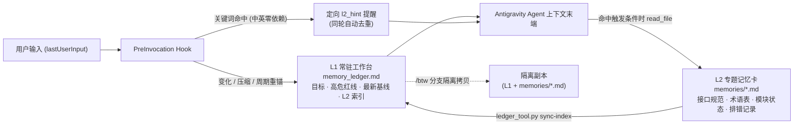

# Context Anchor

<p align="center">
  <strong>Two-Tier Working Memory (L1 Ledger + L2 Topic Cards) for Google Antigravity</strong><br/>
  面向 Google Antigravity 的零依赖 L1 + L2 分层工作记忆插件：防压缩失忆、防多版本串稿、防懒召回、原生支持 <code>/btw</code> 分支隔离。
</p>

<p align="center">
  
  
  
  
</p>

---

## 解决什么问题？

在持续几十到上百轮的深度任务中（如长篇技术方案/架构文档多轮迭代、中大型工程重构、复杂系统设计与调试），大模型工作记忆往往在三个地方失效：

1. **压缩失忆（Compaction Amnesia）**：长对话触发自动压缩或 `/compact` 后，早期敲定的硬参数、红线约束和否决理由极易被过度概括甚至丢失。
2. **多版本串稿（Stale-Version Drift）**：文稿或方案迭代到 v10+ 后，历史对话里混杂着 v1～v9 的废弃草稿，模型容易重新提出已否决方案，或把旧版符号/编号带入最新版。
3. **两难困境——单文件塞不下 vs 二级文档懒得读（Lazy Recall）**：把全部细节塞进单文件很快会超限并浪费上下文；而如果把所有规则都丢进外部按需读取文档或向量库，模型又经常“偷懒不查”，或者把旧版本草稿误召回。

**Context Anchor** 将计算机存储层次引入 Agent 会话管理，用**零第三方依赖、纯本地 Markdown + Antigravity 原生 `PreInvocation` Hook** 一次解决上述三个痛点。

---

## L1 + L2 混合架构



### 核心设计原则

- **L1（`memory_ledger.md`）——常驻热区，绝不下沉高危红线**
  - 始终保持精简（默认 `<= 120 行 / 4000 字符 / 12 KB`，按字符与字节双重计量，消除 UTF-8 中文 3 字节惩罚）。
  - 只存当前目标、**不可违背的硬约束**、当前最新基线版本、简明否决项、下一步，以及底部自动同步的 **L2 索引表**。
- **L2（`memories/*.md`）——按需冷区，平时 0 Token 占用**
  - 将大块结构化知识按主题拆为独立 Markdown 卡片（带极简 YAML Frontmatter：`title` / `trigger` / `keywords` / `updated` / `summary`）。
  - 每次版本迭代**原地覆写卡片为最新定稿**（历史旧稿交给 Git 或回收站），从源头避免旧版幽灵召回。
- **确定性反懒召回（`l2_hint`）**
  - 每轮 `PreInvocation` 自动拿用户输入与 L2 卡片的 `keywords` 做纯 Python 确定性匹配（中文原生子串匹配 + 英文 ASCII 词边界匹配，避免 `"API"` 误命中 `"capital"`）。
  - 即使 L1 未改动，只要命中关键词即注入 2～4 行精简提醒，精准触发 `read_file`，不重复塞入整份 L1，且同一轮内多次工具调用自动去重。

### 与其他记忆方案的定位对比

| 方案类型 | 代表做法 | 优势 | 局限 | Context Anchor v0.3 的取舍 |
| :--- | :--- | :--- | :--- | :--- |
| **纯单文件账本** | 单一 `memory.md` | 简单、零漏读 | 长任务/中文易写满，难以容纳术语表、多章节明细 | 保留为 **L1**，但放宽中文预算并剥离大块明细 |
| **纯索引 + 多文档** | `MEMORY.md` + `*.md` | 可扩展、纯文本可读 | **Lazy Recall**（模型常偷懒不读 L2）；无宿主级压缩/分支联动 | 吸收为 **L2**，用高危约束驻留 L1 + `l2_hint` + `sync-index` 补齐短板 |
| **向量数据库 / RAG** | `Mem0`、Graphiti 等 | 适合海量跨项目历史检索 | 需外部服务/模型；多版本迭代易误召回作废旧稿；不可直接审阅 | 刻意保持**零依赖纯 Markdown**，面向高确定性单项目/长会话工作流 |

---

## 典型使用场景

### 1. 超长多版本技术方案与架构文档
使用 `/context-anchor pin` 将记忆固定到项目目录 `.agents/context-anchor/`，跨多个新会话无缝接力：
- **L1 (`memory_ledger.md`)**：锁死核心技术约束、当前定稿基线（如 `v14`）、接口与规范红线、当前待改模块。
- **L2 (`memories/*.md`)**：按专题拆分并原地覆写——例如拆分为 `api_contract.md`、`glossary.md`、`module_status.md`、`debug_pitfalls.md`。

### 2. 复杂工程调试与 `/btw` 多路线探索
默认使用会话级 `session` 模式（存放在 `<artifactDirectoryPath>/`，不污染代码仓库）：
- 主线对话按需更新 L1/L2，压缩时立刻重锚，未变化时静默零开销；
- 随时发起 `/btw` 支线探索实验方案，插件自动识别唯一真父对话并**隔离拷贝 L1 与全部 `memories/*.md`**；放弃支线零回写污染，升级为主线则继续独立演化。

---

## 智能触发机制

| 触发事件 | 注入策略 | 说明 |
| :--- | :--- | :--- |
| **Turn 1 首轮对话** | `initialized,changed` | 默认 `auto_start: true` 自动建账本并注入；后台子代理会话自动跳过。 |
| **L1 发生修改** | `changed` | 检测 SHA-256 哈希变动（含侧栏手改或 `sync-index` 刷新）后立刻重注入。 |
| **发生上下文压缩** | `compacted` | 检测 `transcript.jsonl` 新增 `CHECKPOINT`（自动压缩或 `/compact`）后立刻重新锚定。 |
| **命中 L2 关键词** | `l2_hint` | 仅注入 2～4 行定向 `read_file` 提示（同轮去重）；若与 L1 触发同轮发生则自动合并。 |
| **持续无变化** | 每 6 轮 `reanchor` | 间隔 `< 6` 轮且无关键词命中时返回 `{}`，零重复堆叠。 |
| **开启 `/btw` 分支** | `inherited,changed` | 复制真父对话的非空白 L1 与 `memories/*.md` 隔离副本；项目固定模式下自动附加只读保护提示。 |

---

## 快速开始

**环境要求**：Python 3.9+（仅使用标准库，**零第三方包、零数据库、零 API 费用**）。

### 安装（Windows）

```powershell
git clone https://github.com/li-tao-yao/context-anchor.git
cd context-anchor
.\scripts\install.ps1
```

插件将同步至 `C:\Users\<用户名>\.gemini\config\plugins\context-anchor\`。打开 Antigravity 桌面端左侧 **Customizations → Installed** 即可看到 **Context Anchor** 卡片，开启后对所有项目自动生效。

### 安装（macOS / Linux）

```bash
git clone https://github.com/li-tao-yao/context-anchor.git
cd context-anchor
chmod +x ./scripts/install.sh
./scripts/install.sh
```

### 更新与验证

```powershell
git pull
python -m unittest discover -s tests -v
.\scripts\install.ps1
```

### 卸载

```powershell
.\scripts\install.ps1 -Uninstall
```

---

## 常用指令与 CLI 速查

### 对话内自然指令（`/context-anchor`）
- `/context-anchor start`：初始化并填充当前会话账本
- `/context-anchor compact`：整理精简 L1、将大块参考信息下沉为 L2 卡片并校验
- `/context-anchor pin` / `unpin`：将 L1 + `memories/*.md` 固定到工作区 `.agents/context-anchor/` 或解除固定
- `/context-anchor pause` / `resume`：暂停或恢复当前账本自动注入
- `/context-anchor status`：查看模式、行数/字符数/字节数、L2 卡片清单与索引同步状态

### L2 专题记忆卡片格式与 CLI

每张 L2 卡片保存在同级 `memories/<slug>.md`：

```markdown
---
title: 核心接口与字段规范
trigger: 修改后端接口、请求字段或错误码定义前必读
keywords: [接口, 字段, 错误码, API, schema]
updated: 2026-11-26
summary: 统一管理全部核心 API 字段命名、分页格式与错误码约定
---

# 核心接口与字段规范

- 分页响应统一使用 `items` / `total` / `next_cursor`
- 错误码按模块前缀划分（`AUTH_*`、`SYNC_*`）
```

通过 `scripts/ledger_tool.py` 管理（自动维护 L1 底部索引，避免手工双写漂移）：

```powershell
# 新建或原地更新 L2 卡片并自动同步 L1 索引
python scripts/ledger_tool.py memory-save --target "<ledger_path>" `
  --name "api_contract" --title "核心接口与字段规范" `
  --trigger "修改接口或字段定义前必读" --keywords "接口,字段,错误码,API" `
  --summary "统一管理核心 API 字段命名与错误码约定" --body-file "draft.md"

# 列出所有 L2 卡片 / 重新同步索引 / 删除废弃卡片 / 体积与同步检查
python scripts/ledger_tool.py memory-list   --target "<ledger_path>"
python scripts/ledger_tool.py sync-index    --target "<ledger_path>"
python scripts/ledger_tool.py memory-delete --target "<ledger_path>" --name "obsolete"
python scripts/ledger_tool.py check         --target "<ledger_path>"
```

---

## 个性化配置

如需调整默认参数，不要直接改仓库文件，新建用户配置文件 `~/.gemini/antigravity/plugin_data/context-anchor/config.json` 覆写所需字段（升级插件时自动保留）：

```json
{
  "auto_start": true,
  "skip_subagents": true,
  "auto_detect_after_turns": 6,
  "auto_detect_recheck_turns": 6,
  "reanchor_every_turns": 6,
  "max_lines": 120,
  "max_chars": 4000,
  "max_bytes": 12288,
  "l2_index_max_entries": 40,
  "l2_keyword_hints": true,
  "l2_max_hint_matches": 3
}
```

---

## 项目结构

```text
context-anchor/
├── plugin.json                      # Antigravity 插件清单
├── hooks.json                       # PreInvocation 生命周期钩子
├── config.default.json              # 默认阈值与 L2 配置
├── assets/logo.svg                  # 插件图标
├── rules/AGENTS.md                  # 常驻 L1 + L2 工作记忆协议
├── skills/context-anchor/SKILL.md   # /context-anchor 管理技能
├── scripts/
│   ├── common.py                    # 配置、L2 Frontmatter/索引/匹配、分叉检测与注册表
│   ├── pre_invocation.py            # PreInvocation 增量注入与 l2_hint 引擎
│   ├── ledger_tool.py               # L1/L2 CLI 管理工具
│   ├── install.ps1                  # Windows 安装 / 更新 / 卸载脚本
│   └── install.sh                   # macOS / Linux 安装脚本
└── tests/
    └── test_context_anchor.py       # 自动化测试套件（29 项单元测试与集成冒烟）
```

## 版本记录

- **v0.3.0**：引入 L1 + L2 分层架构（`memories/*.md` + YAML Frontmatter）、`ledger_tool.py` 的 `memory-save/list/delete/sync-index` 命令、中英文公平字符预算（`4000 chars / 12 KB`）、零依赖关键词定向提醒（`l2_hint`）、以及 `/btw` 分支与 `pin`/`unpin` 的全量 L2 隔离拷贝（29 项测试全通过）。
- **v0.2.0**：完善 `/btw` 真父对话定位与兄弟分支隔离、修复宿主 `systemMessage.metadata` 兼容性、启用 Turn 1 默认 `auto_start`、扩展至 21 项测试。
- **v0.1.0**：初版单文件 L1 工作记忆账本、压缩重锚与项目固定模式。

## 隐私与安全

- 所有状态、L1 账本与 L2 卡片**100% 存储在本地**，零网络调用、零数据上传。
- 内置协议禁止在记忆文件中写入密码、API Key、Token、Cookie 或私钥明文。
- Hook 采用 **Fail-Open** 设计：任何异常均静默输出 `{}` 并以退出码 `0` 返回，绝不阻塞主对话。

## License

MIT
